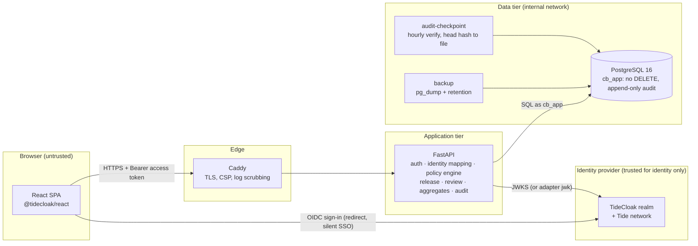
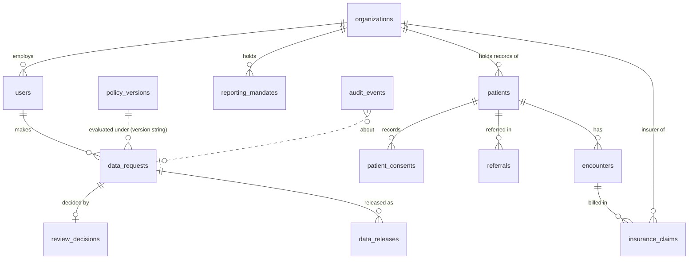
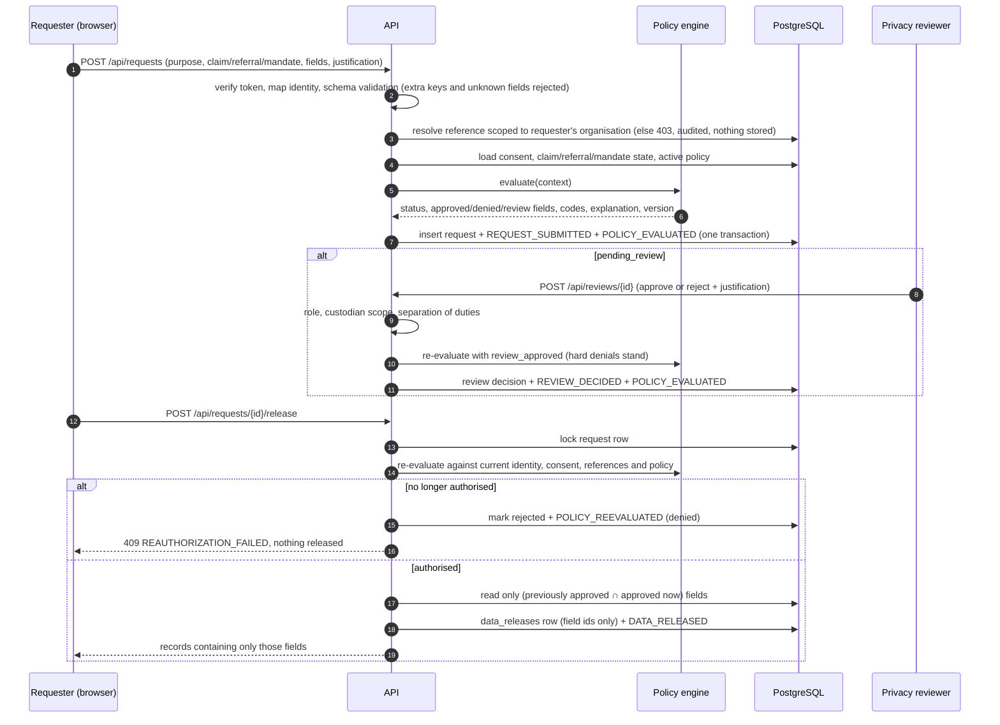

# Architecture

ConsentBridge is a single-page React application, one FastAPI service and one PostgreSQL database behind a
Caddy edge. There are no other services: the policy engine, audit chain and aggregation run inside the API
process so that every disclosure path passes through the same code.

## Components and trust boundaries

Trust boundaries, from the outside in:

1. **Browser → edge.** Everything from the browser is untrusted: bodies, headers, query strings, and any
   role or organisation the UI shows. The UI hides controls for convenience only.
2. **Token → identity.** The API trusts a token only after verifying signature, algorithm, issuer, expiry,
   `azp` and `typ` itself. A verified token establishes *who*, nothing more.
3. **Identity → authority.** Role and organisation come only from the `users` row linked to the token's
   issuer and subject by an administrator or operator. Token claims, headers and body fields cannot change them.
4. **API → database.** The API connects as `cb_app`, which has no `DELETE` on any table and only
   `INSERT`/`SELECT` on `audit_events`, `review_decisions` and `data_releases`. Migrations use `cb_owner`.
   A trigger blocks `UPDATE`/`DELETE`/`TRUNCATE` on `audit_events` for every role.

## Backend modules

| Module | Responsibility |
|---|---|
| `app/auth/tidecloak.py` | Verifies access tokens (mirrors Tide's `@tidecloak/verify`, plus required claims, `typ`, 503 on key-fetch failure). |
| `app/auth/identity.py` | Maps verified issuer + subject to a user, checks active status, audits denials and session starts, provides `require_roles`. |
| `app/policy/catalog.py` | Server-defined field catalogue. The only identifiers a client may name. |
| `app/policy/document.py` | Versioned policy schema with guard rails, and the initial policy. |
| `app/policy/engine.py` | Pure, deterministic `evaluate(context) -> PolicyResult`. No I/O; fails closed. |
| `app/services/context.py` | Builds evaluation contexts from the database, scoped to the requester's organisation. |
| `app/services/requests.py` | Create, preview, visibility scoping, release with re-authorisation, review with separation of duties. |
| `app/services/aggregates.py` | Aggregate computation with primary and complementary suppression. |
| `app/audit/chain.py` | Canonical serialisation, append under advisory lock, chain verification. |
| `app/api/*.py` | Routes. Every `/api` route except health authenticates; each route authorises. |
| `app/cli.py` | Operator commands: bootstrap, seed, link identity, create admin, verify audit. |

## Data model

Key constraints: one active policy (partial unique index), unique `(external_issuer, external_subject)`,
request scope shape (`patient` requests have a patient and no aggregate query, and vice versa), one review
decision per request, justification length ≥ 20, contiguous unique audit `seq`, hash lengths of 64.

## Request lifecycle

## Frontend

- `TideCloakContextProvider configUrl="/tidecloak.json"` wraps the app. `/auth/redirect` completes
  sign-in; `public/silent-check-sso.html` supports silent session checks.
- `RequireSession` admits a route only when TideCloak reports an authenticated session **and** `/api/me`
  succeeds. A 401 from any call triggers re-authentication; an expired session returns to sign-in with a message.
- `useApi` obtains a fresh token with `getToken()` per call, sends it as a Bearer header, omits cookies and
  disables caching.
- Pages: Overview, Requests, New request, Request details (with release and review), Review queue,
  Released data, Patient records (custodian hospital only), Statistics (government), Audit trail (with
  verification), Policy, Administration.

## Configuration

All configuration is environment-based (`CB_*`, see `backend/.env.example` and `deploy/.env.example`).
Production refuses wildcard CORS, unset trusted hosts, a minimum group size below 5, and symmetric or `none`
token algorithms. Secrets are Docker secrets files, never in images, compose files or the browser bundle.
